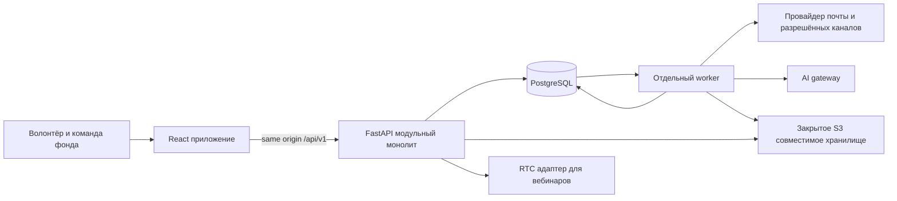

# Технический план реализации Опоры

Дата: 21 октября 2026. Стек подтверждён: **React + TypeScript, FastAPI, PostgreSQL**.

Цель — перенести весь согласованный дизайн и механики волонтёрской платформы в приложение с серверным сохранением, реальными пользователями, правами доступа и интеграциями. Основа — модульный монолит: один API, одна PostgreSQL, отдельный процесс фоновых задач и React-приложение. Доменные модули позволяют нескольким агентам работать параллельно без микросервисов.

План охватывает все 41 артборд: 35 целевых визуальных поверхностей и состояний, 4 старых дубля, 2 служебных экрана. Полная готовность означает завершение всех пакетов P00–P20. Первый рабочий контур и пилот фонда — промежуточные этапы, а не сокращение общего объёма. Дополнительно согласован самостоятельный путь записи урока без аудитории с готовым кадром преподавателя и презентации, предпросмотром и публикацией; новые состояния перечислены в new-mechanics.csv.

## Как пользоваться планом

1. [Карта всех экранов](screen-map.csv): что переносим, куда, кто отвечает, чем принимаем.
2. [База данных и инварианты](data-model.md): таблицы, состояния, повторения, бронирования, права и миграции.
3. [API и фронтенд](api-and-frontend.md): команды, DTO, ошибки, компоненты и интеграции.
4. [Пакеты мультиагентной реализации](work-packages.md): владельцы файлов, зависимости, волны и готовые задания.
5. [Снимок источников](reference-snapshot.json): commit и SHA-256 файлов на момент подготовки плана.
6. [Граф зависимостей](work-graph.json): контрольные задачи для 21 основного пакета; P10, P17 и P18 разбиты на контрольные части; граф также содержит расписание без пересечения владельцев.
7. [Повторное использование Общего Дела](platform-reuse.md): auth, API, БД, jobs, загрузки, кеши, frontend и эксплуатация.
8. [Студия и запись уроков](studio-recording.md): shared stage, live/solo, дубли, обработка, просмотр и публикация.
9. [Независимое ревью Astra](astra-review.md): найденные несогласованности, внесённые исправления и границы проверки.

На момент подготовки плана в репозитории не было backend/workspace/миграций. Теперь рабочая реализация находится в `apps/` и `packages/`; фактические проверки и незавершённые гейты перечислены в [progress.md](progress.md). Существующий прототип использует `DCLogic`, генерацию `.dc.html` и browser storage. Эти исходники — спецификация поведения и дизайна, а не каркас будущего backend. См. [описание прототипа](../../prototype/README-opora.md), [сборку](../../scripts/build_prototype.py), [текущую логику интервью](../../prototype-src/interview-store.js).

На момент снимка в рабочем дереве есть незакоммиченные изменения прототипа. До реализации интегратор фиксирует согласованный вариант отдельным reference commit. Последний commit сам по себе не описывает все текущие экраны; manifest хранит фактические хеши. Незаконченная UX-проверка не считается пройденной production-приёмкой.

Актуализация 21 октября: включены изменения Арама до `f7a6f6d` (основная анкета по шагам, компактный выбор направлений, навыки по выбранным направлениям, карточка пути и обновлённый кабинет). Варианты **анкеты** 2/3 сняты самим автором в `0a8b458`; при переносе их не восстанавливать. Варианты **знакомства** из `f7a6f6d` (карточки, темы списком) автор объединил в один экран: подача каждого шага задаётся полем `mode` (`cards` — история и кодекс, `feed` — люди и общение) в `prototype/content/onboarding.js`; отдельные экраны вариантов удалены, не восстанавливать. Кнопку «Пройти тест ещё раз» автор не включает: повторного прохождения теста нет. В `a698bee` включены мобильные правки анкеты и выбора дня встречи. Предыдущий `reference-snapshot.json` остаётся историческим снимком; перед реализацией P00 фиксирует новый объединённый reference commit.

## Принятые продуктовые ограничения

| Правило | Реализация |
|---|---|
| Сохранить стиль исходной «Опоры» | Токены, Inter, исходные SVG, белые карточки, тёплый фон и размеры из кита; перенос в общую UI-библиотеку |
| Навигация только сверху | Логотип и «Опора» на одной линии с меню на desktop; раскрытие разделов по стрелке; на телефоне компактный верхний выбор. Боковое меню не добавлять |
| Не ограничивать календарь шестью неделями | Произвольные даты и диапазоны, месяц/неделя/список; технический горизонт материализации не ограничивает интерфейс |
| Направления, роли и подготовку редактирует координатор | Справочники и правила по роли/возможности, версии, история и явное согласование исключений |
| Нет универсального обещания «около трёх недель» | Подготовка зависит от роли; готовность приходит из API с причинами, не вычисляется по фиксированной цепочке |
| Отклик, согласование и подтверждение различаются | Независимые команды координатора и волонтёра; attendance фиксируется отдельно |
| Исторический контакт не равен готовому волонтёру | Импорт в очередь проверки; актуальная доступность и договорённость обязательны для статуса ready |
| Карточки участников доступны по назначению | Сервер отдаёт разрешённую памятку только своему назначенному волонтёру; внутренние заметки отдельные |
| Новичок — полноценный пользователь | В кабинете видны следующий шаг, встреча, первый выход, кто встретит, задачи, подготовка и контакт |
| Текущий тест знакомства — учебный | В актуальном прототипе 4 модуля и 10 вопросов; завершение обновляет прогресс знакомства, но не блокирует запись на встречу; проходной процент не добавлять |

В пользовательском интерфейсе применять [словарь фонда](../../materials/05-продукт/Словарь%20фонда.md): «занятия и мероприятия», «участники», «координатор волонтёров». Имена старых файлов `Shifts`/`FirstShift` остаются только в карте совместимости.

Текущий validator содержит 16+, хотя пользователь отменял требование 18+ и не утверждал новый порог. Не переносить 16+ как установленное правило: выделить policy и согласовать возрастные условия до запуска. Справка по принятому запросу желательна; если фонд установит обязательность для конкретной роли, её задают отдельной настройкой, а не общей блокировкой. Тексты вопросов и материалов Фёдора не переписывать при техническом переносе.

Дополнительно к canvas учесть карточку занятия `prototype/Event.html` из `55d7e80`: маршрут `/fund/events/:id`, общий с расписанием экземпляр серии и состав команды, приёмка P08/P09.

## Архитектура



### Повторное использование до новой реализации

Второй reference — рабочий curator-bot/«Общее Дело», commit38c92cd49b1b6c229ed473de991479ed261e4052. Его стек близок выбранному; подробная карта портирования — в platform-reuse.md. Перед реализацией каждого общего механизма агент проверяет существующий модуль и переносит изолируемую логику вместе с tests. DB/auth/provider boundaries адаптируются под Опору; школьные платежи/тарифы/Telegram identity и production окружение не переносятся. Существующие оптимизации учитываются в P01/P02, а не откладываются до полного переписывания приложения.

### Компоненты

| Слой | Выбор и назначение |
|---|---|
| Web | React + TypeScript + Vite; React Router; TanStack Query для серверных данных; React Hook Form и схемы валидации для форм |
| UI | Собственные компоненты на токенах «Опоры»; проверенные headless primitives допустимы, визуальный стиль контролирует проект; Storybook для состояний |
| API | FastAPI, Pydantic, SQLAlchemy, Alembic; HTTP API с OpenAPI; сервисные транзакции через SQLAlchemy Session/UoW без собственного generic framework |
| БД | PostgreSQL; FK, unique/check/exclusion constraints, row locks, JSONB только для snapshots/контента/настроек |
| Worker | Отдельный процесс из того же Python-пакета; durable очередь jobs/outbox в PostgreSQL, retries и leases; Redis не обязателен в первом контуре |
| Файлы | Закрытый S3-compatible storage; локальный совместимый сервис в dev; проверка и обработка загружаемых изображений |
| Auth | Серверные сессии в Secure HttpOnly cookies; подтверждённый контакт; staff accounts и разрешения выдаются явно |
| Интеграции | Адаптеры почты, SMS/мессенджеров, AI, RTC, таблиц. Каждый подключается отдельным флагом; пустой адаптер не сообщает об успешной доставке |
| Dev/CI | Python lockfile, pnpm lockfile, Docker Compose, pytest/PostgreSQL, frontend tests, browser E2E, visual regression |

Точные совместимые версии фиксируются в P00 в lockfiles и образах; агенты не выбирают разные версии независимо. Next.js, отдельный BFF, Kubernetes и микросервисная шина для исходного объёма не требуются. Публичные страницы можно добавить к этому frontend без переноса бизнес-логики в web-сервер.

### Структура будущего кода

```text
apps/
  web/src/
    app/                 # router, layouts, permissions, navigation, providers
    ui/                  # токены и общие компоненты
    features/<module>/   # pages, components, api-hooks, schemas, tests
    api/generated/       # генерируется из OpenAPI
  api/
    app/
      main.py
      core/              # config, db, auth, errors, audit, clock
      modules/<module>/  # router, schemas, service, repository, models, policies
      integrations/      # delivery, storage, ai, rtc, sheets
      worker/            # jobs, outbox, leases, retries
    migrations/          # один владелец и линейная цепочка Alembic
    tests/
packages/
  contracts/             # собранный OpenAPI, кодогенерация и общие fixtures
  design-tokens/
tests/
  e2e/ visual/ contract/
infra/
  compose/ proxy/ observability/ backup/
docs/implementation/
```

Все бизнес-правила живут в API service/policy слоях. Роутер проверяет сессию и входные данные; repository не решает, кто допущен к занятию. Междоменные вызовы идут через небольшие публичные service functions (без отдельного abstraction layer на каждую таблицу) и одну транзакцию, где требуется атомарность; модули не меняют чужие таблицы из роутера. Outbox создаётся в той же транзакции, что и бизнес-изменение.

## Сквозные контуры

### Кандидат и собеседование

`Анкета → кабинет → [выбор времени и запись || знакомство с фондом и тест] → встреча с координатором → итог → первый выход`.

После отправки анкета находится на проверке. Выбор времени и знакомство доступны параллельно: завершение теста не является условием бронирования. Знакомство желательно пройти до встречи; координатор видит оба независимых состояния.

- Черновик сохраняется на сервере либо в ограниченной регистрационной сессии, до отправки не считается анкетой в очереди.
- Отправка идемпотентна; аккаунт имеет UUID. Совпадение email не даёт доступ к существующему человеку.
- Кабинет открывается сразу в текущем браузере для отправленной им заявки. До подтверждения контакта такая сессия ограничена этой регистрацией и не раскрывает существующие записи. Рекомендуемый рубеж подтверждения контакта — до бронирования; это отдельное явно описанное состояние UI.
- Возврат — одноразовая ссылка/код в подтверждённый канал; staff — отдельный вход с MFA. Редактирование анкеты создаёт ревизию, не сбрасывает обучение и встречу. Изменение контакта проходит повторное подтверждение.
- Прогресс привязан к опубликованной версии обучения. Тест проверяет сервер; прокрутка — удобство чтения, а не защита допуска.
- Telegram в прототипе — демонстрационный переключатель, а не подтверждённое подключение. В реализации нужен одноразовый токен привязки бота и подтверждение сервером; выбор напоминаний не доказывает привязку. SMS не обещать без отдельного согласованного канала.
- Координатор задаёт окна, повторение, исключения, длительность, перерыв и место; слот занят только после успешной транзакции.
- При переносе старая запись сохраняется до атомарного подтверждения новой. Два одновременных запроса не могут занять одного координатора.
- Итог встречи и частная заметка различаются. Следующий шаг имеет ответственного, срок и историю, а не только текст в карточке.

Решение о конкретном канале входа не блокирует разработку: dev-почта и адаптер доступны с P01. Подключение реального отправителя — гейт запуска, не повод имитировать доставку.

### Возможность и участие

`Роль → возможность → занятие/серия → потребности по ролям → отклик/приглашение → согласование → подтверждение → участие → часы → рефлексия`.

Роль — шаблон задач и подготовки; возможность — опубликованное предложение; занятие — конкретная дата; потребность — сколько людей какой роли нужно на этой дате. На одном занятии могут быть ассистенты, педагог и фотограф. Изменение шаблона роли не переписывает договорённости уже подтверждённого занятия.

Обязательные действия координатора: создавать/изменять потребности, приглашать, согласовывать, переносить, фиксировать факт и разбирать рефлексию. Волонтёр откликается, подтверждает или отказывается. В API отдельно возвращаются `required`, `invited`, `confirmed`; приглашение само по себе место не заполняет.

Памятка первого выхода строится из занятия, группы, встречающего и требований. Подтверждённый факт создаёт запись минут; исправления часов оставляют историю. Добровольная рефлексия не блокирует начисление уже подтверждённых часов.

### Участники и группы

Координатор редактирует карточки, фото, памятки и состав групп. Связь состава имеет период действия; конкретное занятие может иметь уточнённый состав. Волонтёр получает только разрешённую памятку назначенного занятия/группы; URL с UUID не даёт доступ. Внутренние заметки, контакты и разрешения фото не включаются в volunteer DTO.

### Остальные экраны тоже входят в реализацию

| Блок | Реальные механики вместо демонстрации |
|---|---|
| Академия, уроки, Builder | Версии треков/уроков, редактор блоков, публикация, задания, прогресс, тесты, доступность по роли |
| Simulator и Scenarios | Версии сценариев/рубрик, тренировочный диалог, подсказка, пауза, остановка, оценка по критериям, спор с оценкой и передача специалисту |
| Mentor и Knowledge | Опубликованные источники, поиск/индекс, ответ со ссылками на конкретные фрагменты, отсутствие ответа, очередь вопросов и редактор ответов |
| Studio и «Записать урок» | Адаптированный движок Общего Дела: одинаковая сцена преподаватель+презентация для live и MP4, RTC, доска, capture/render jobs; отдельные solo project/takes, приватный preview и явный publish |
| Messages | Диалоги и участники, unread cursors, вложения, отправка/повтор/ошибка, история внешней доставки |
| Signals | Правила сигналов, назначение ответственного, срочность, действие, закрытие с причиной, ограничение доступа к чувствительным кейсам |
| Reports и Hours | Расчёт по исходным данным, объяснимый период/метрика, реальные PDF/CSV/DOCX, запрос и согласование часов, справки, благодарности и выгрузка Добро.ру |
| Admin | Команда и permissions, dry-run импорта, разбор дублей, интеграции, шаблоны, AI-бюджеты, настройки и журнал |
| Profile | Свой профиль и доступность, пауза, каналы и согласия, подтверждение изменения контакта, экспорт/удаление по согласованной политике, AI-предложения изменений с принятием/отказом/отменой |

AI и RTC — самостоятельные пакеты, а не «подключить ключ». Фиксированные 94 совместимости, 6 из 10 в тренажёре и заранее написанные ответы не становятся алгоритмом при переносе HTML. Для отсутствующего провайдера показывается честное недоступное состояние; полный план остаётся незавершённым, пока соответствующие механики не реализованы.

## Доступ и внешние данные

Разрешения проверяются в API, выборке данных, выдаче файлов, экспортах и фоновых jobs. UI `allowed_actions` помогает показать доступные кнопки, но не даёт права выполнить команду. Администратор технической системы не получает автоматически все частные заметки.

Фотографии — закрытые assets, не DataURL в JSON. Импорт — `upload → mapping → preview/dry-run → apply → очередь проверки`. Повтор одного batch не создаёт дубли; ошибочные строки остаются в отчёте. Импорт не отправляет приглашения. Сырые реальные базы и фото не копируются в seeds, git или dev-логи.

Подбор начинается с проверяемых критериев: интересы, навыки, подтверждённая доступность, подготовка и знакомство с группой. Недостаток данных показывается явно. AI может объяснять и предлагать; решение и отправка приглашений по умолчанию у координатора. Возраст/пол не используются как замена способности выполнить конкретную задачу.

## Порядок реализации

| Этап | Результат и выходной гейт |
|---|---|
| G0 Контракт | Reference commit, карта экранов, schema/enums, OpenAPI, permissions, UI tokens и shared header; один владелец миграций |
| G1 Первый рабочий контур | Настоящая БД и две сессии: анкета, версии знакомства, тест, бронирование и координатор; конфликт записи и отзыв доступа проверены |
| G2 Операционная работа фонда | Роли/возможности/повторения/команда, участники/группы, CRM/резерв, первый выход, факт/часы/рефлексия, коммуникации и импорт |
| G3 Весь объём дизайна | Академия/редакторы, знания/тренажёр/наставник, Studio и solo-запись с публикацией, отчёты/справки, настройки, все legacy states перенесены или явно объединены |
| G4 Запуск | Staging, интеграции, backup/restore, ACL/race tests, визуальная приёмка, точный deploy SHA и проверка обеих ролей |

Сначала P00–P02; затем анкета P03, подготовка P04 и собеседования P06, параллельно роли P07 и база участников P10A. Календарь P08 и участие P09 идут после своих контрактов, интеграция доступа к группе P10B — после P09. Следующие волны описаны в [пакетах](work-packages.md). Временную оценку давать после spike бронирований/повторений и RTC; число агентов само по себе не означает линейное ускорение.

## Приёмка и эксплуатация

- Новые browser E2E используют API и настоящую PostgreSQL, отдельные контексты волонтёра/координатора. Старые VM-проверки остаются reference, но не доказывают конкурентность или права.
- Обязательны races бронирования/подтверждения места, атомарный перенос, идемпотентные минуты/импорт/отправка, запрет чужих данных и отсутствие private fields в ответах.
- Визуальные эталоны: 390/768/1050/1440 CSS px, ключевые состояния форм/дропдаунов/календаря/редактора. Проверять фокус, клавиатуру, 200% масштаб, reduced motion, большие кнопки для старших волонтёров. Логотип и desktop-меню на одной линии.
- Backend CI: lint/typecheck, unit, интеграция с PostgreSQL, миграции с пустой и предыдущей схемы, ACL и гонки. Frontend CI: typecheck, component tests, OpenAPI client drift, E2E и согласованные visual baselines.
- Jobs имеют повтор, lease, dead-letter и операционную очередь ошибок. Если worker упал после отправки, provider idempotency key и журнал помогают сверить исход; ровно однократную внешнюю доставку без поддержки провайдера не обещать.
- Деплой: web/API/worker images с одним release SHA, миграции отдельным шагом, readiness/health/version. Отдельные dev/staging/prod данные и секреты.
- Backup PostgreSQL и storage, тест восстановления, мониторинг возраста outbox, ошибок провайдеров, failed jobs и БД. Предварительные цели для согласования: RPO 1 час, RTO 4 часа; backup-режим должен фактически обеспечивать выбранные цели.
- Откат: совместимый предыдущий app image и expand-contract миграции; остановить отправки при инциденте. Не запускать автоматически destructive down migration и не откатывать БД с потерей новых заявок.

## Решения до запуска с реальными людьми

Эти решения не блокируют разработку на обезличенных fixtures, но должны иметь владельца и срок до G4.

1. Канал входа/восстановления, реальный отправитель, budget SMS, staff accounts и ответственный за доступы.
2. Возрастная политика и требования по ролям; матрица справки/допуска; кто может зафиксировать исключение.
3. Какие фото/поля участников показывать назначенному волонтёру и как долго; кто утверждает правила и хранение.
4. Утверждённые практические материалы общения и эскалации; какие изменения обучения требуют повторного ознакомления.
5. Как фиксируются attendance, минуты, корректировки и выдача справок; кто утверждает.
6. Исходные файлы, форматы и владельцы исторической базы, групп и мероприятий; правила ручного объединения дублей.
7. AI-провайдер, допустимые данные, источники/рубрики, бюджет; отдельно решение об автоматических приглашениях.
8. Изолированное LiveKit/recording окружение или иной согласованный RTC-хостинг, разрешение записи, хранение и доступ к материалам вебинаров.
9. Оператор эксплуатации, домен/хостинг, регион хранения, backup/restore и обработка ошибок доставки.

## Источники и проверенные технические опоры

Требования: [фактура фонда](../../materials/03-исследование/Фактура%20со%20встречи%20с%20фондом.md), [функциональные блоки](../../materials/05-продукт/Функциональные%20блоки%20и%20гипотезы.md), [CJM](../../materials/04-дизайн/CJM/README.md), [кодекс](../../materials/02-фонд/кодекс-этики/README.md), текущие `prototype-src/`, `prototype/content/` и архив дизайн-кита. Пользовательские решения этой задачи приоритетнее старых предположений прототипа.

FastAPI публикует OpenAPI, из которого можно генерировать клиент: [официальная документация](https://fastapi.tiangolo.com/advanced/generate-clients/). Серверный query cache во frontend опирается на [TanStack Query](https://tanstack.com/query/latest/docs/framework/react/overview). PostgreSQL поддерживает exclusion constraints для непересекающихся диапазонов: [range types](https://www.postgresql.org/docs/current/rangetypes.html); захват строк описан в [locking](https://www.postgresql.org/docs/current/explicit-locking.html). Optimistic versioning: [SQLAlchemy](https://docs.sqlalchemy.org/en/20/orm/versioning.html). Durable outbox — проектное решение; простые [FastAPI BackgroundTasks](https://fastapi.tiangolo.com/tutorial/background-tasks/) не заменяют описанный журнал задач и повторов. Основной RTC-путь — адаптация существующего [LiveKit](https://docs.livekit.io/intro/overview/) движка Общего Дела; P18 spike проверяет переносимость и режим записи, а не начинает выбор провайдера с нуля.
