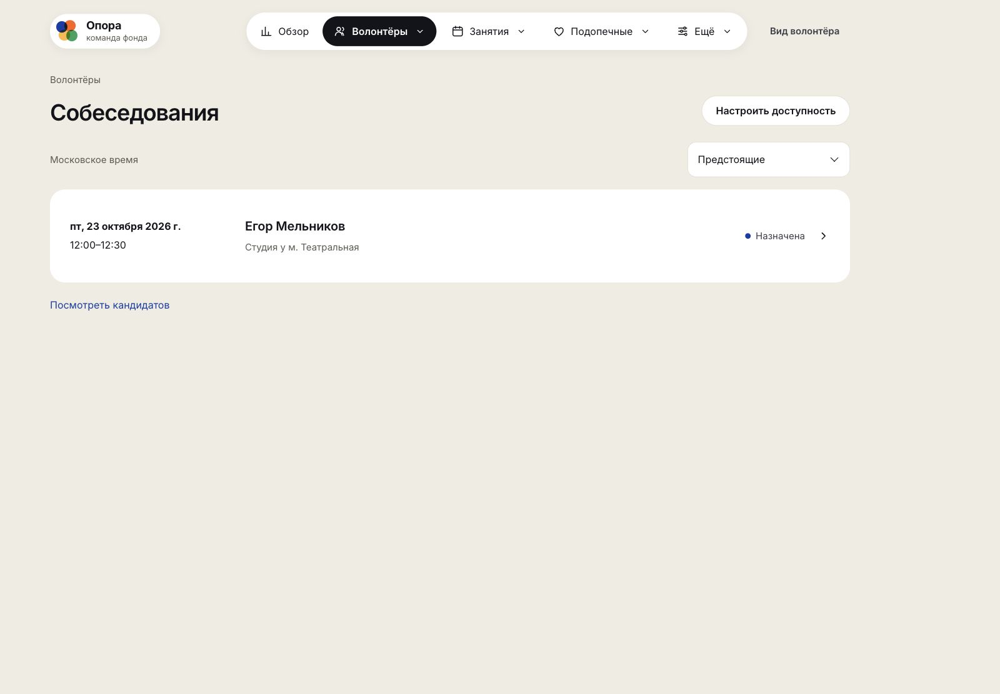
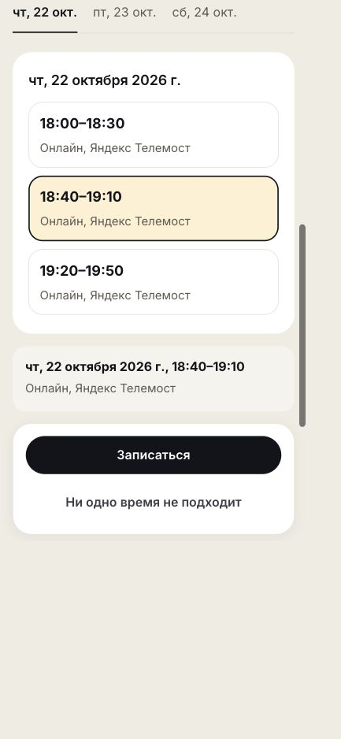
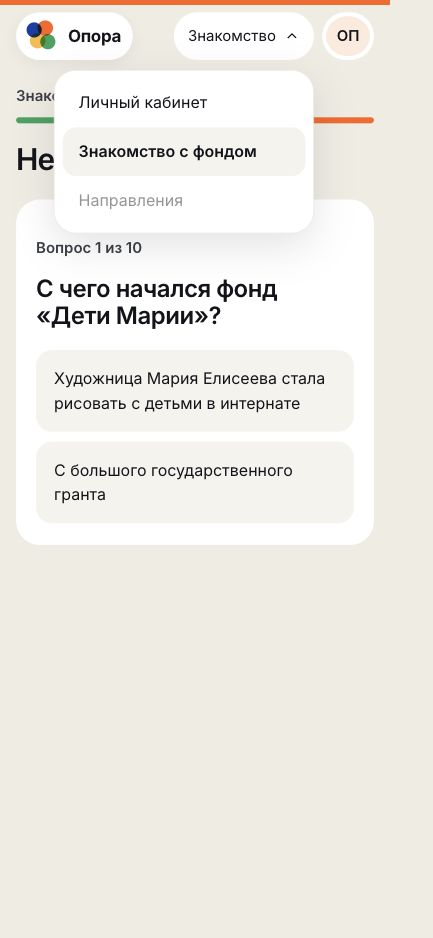
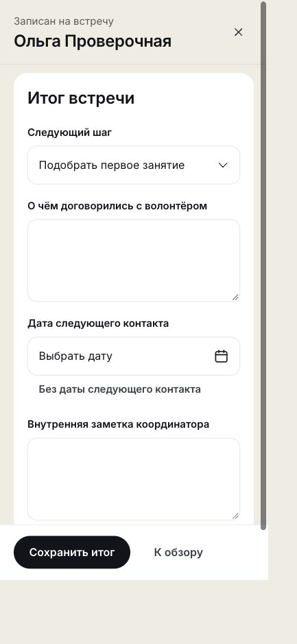
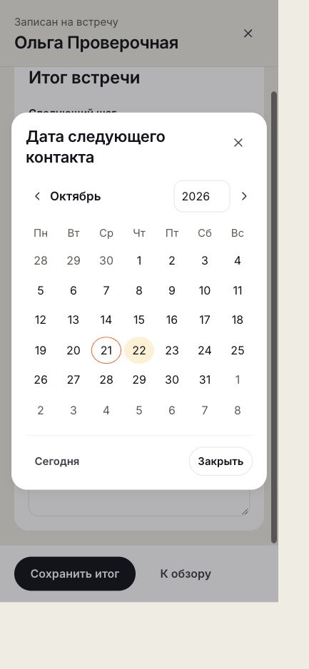
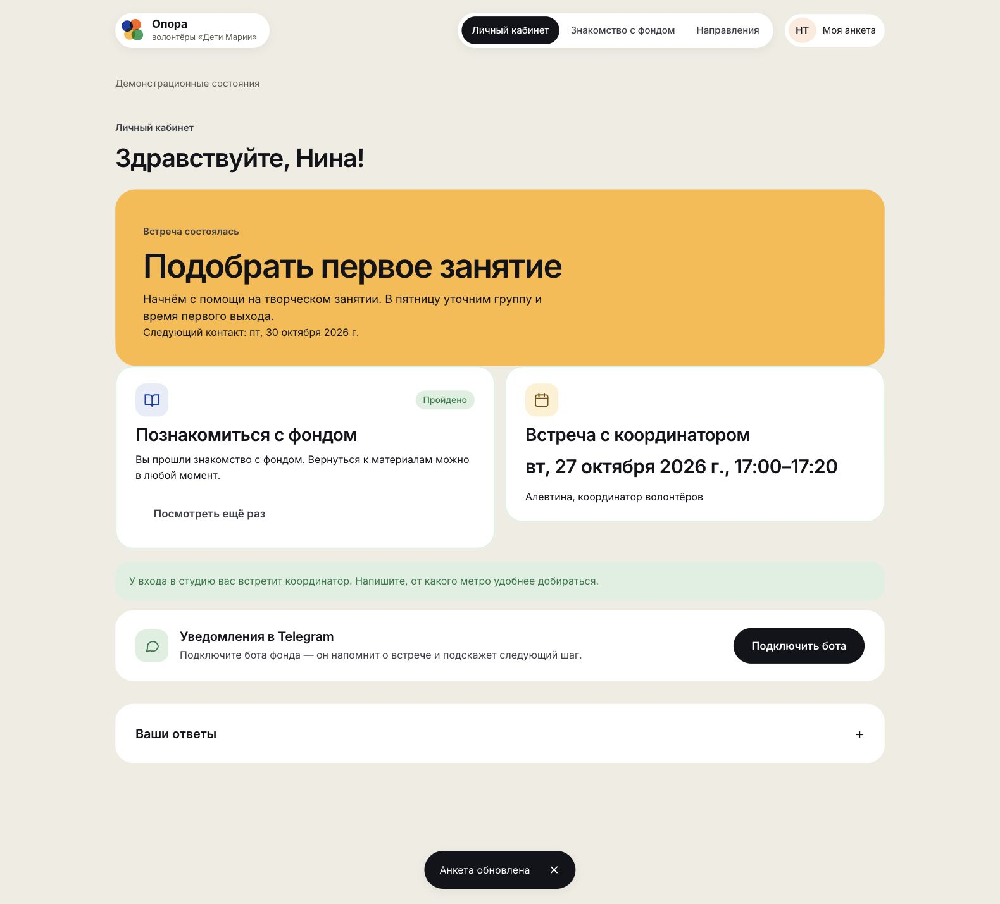

# Проверка пути волонтёра и координатора

21 октября 2026. Локальный интерактивный прототип, демонстрационные персонажи. Итог: пройдено с исправлениями.

## Путь и результат

1. **Анкета из трёх шагов — пройдена.** Заполнена вручную за Нину Тестовую: контакты, интересы, опыт и условия. Дата рождения форматируется, ответы передаются координатору. Исходные состояния: `01-form-start.png`, `02-about.png`, `03-final-form.png`.
2. **Знакомство — пройдено.** Четыре материала, переход после прочтения, верные и неверные ответы в ситуациях. На компьютере и телефоне. Снимки `05`–`08`, `26-onboarding-mobile.png`.
3. **Тест — пройден.** Все 10 вопросов, оба вида пояснений, завершение с 4/10, возврат в кабинет. Повторный тест доступен и не снимает завершённое знакомство. `09-test-feedback.png`, `10-test-result.png`, `27-test-feedback-mobile.png`, `28-test-result-mobile.png`.
4. **Запись — пройдена.** Свободные дни, выбор времени, помощь с дорогой, передача координатору. В итоговой версии сохранён новый сценарий Фёдора: записаться можно до завершения знакомства. Это отдельно пройдено за Ольгу Проверочную на телефоне. `17-compact-booking.png`, `22-parallel-mobile.png`, `23-booking-mobile.png`, `24-booked-nudge-mobile.png`.
5. **Перенос и отмена — пройдены.** Координатор перенёс встречу Нины, изменение появилось в кабинете. Волонтёр отменил запись и записался заново на интервал, который только что создал координатор. Отказ от отмены оставляет запись. `25-cancel-mobile.png`.
6. **Доступность координатора — пройдена.** Создано время 27 октября, 17:00–18:00, встречи по 20 минут и перерыв 10 минут. Ввод `1700` преобразован в `17:00`. Оба интервала появились у волонтёра без перезагрузки. `16-availability-created.png`.
7. **Редактирование и связь — пройдены.** Изменена почта Нины: анкета осталась одна, прогресс и назначенная встреча сохранены. Вопрос волонтёра появился у координатора; ответ координатора появился в кабинете. Кнопки внешнего контакта проверены по адресам, сообщения через Telegram/почту не отправлялись. `15-question-handoff.png` показывает исходное состояние вопроса, итоговая версия поддерживает ответ внутри прототипа.
8. **Итог — пройден.** Координатор сохранил публичную договорённость, внутреннюю заметку и дату следующего контакта. Волонтёр увидел договорённость и дату. Внутреннего текста в его DOM нет. `18-coordinator-outcome-after.png`, `30-coordinator-form-mobile.png`, `32-candidate-final-desktop.png`.

## Что исправлено

- Логотип, название и навигация стоят на одной линии: и в широком кабинете, и в мобильной шапке. Верхняя навигация сохранена. На телефоне — выбор раздела по стрелке.
- В кабинете кандидата показываются его имя и инициалы. Анкета редактируется, интересы видны в краткой карточке, демонстрационные переключатели свёрнуты. Посторонние деморазделы не уводят новичка из текущего пути.
- Вместо всей недели сразу показываются времена выбранного дня. Перед подтверждением видны дата, время и место. Помощь с дорогой предлагается для очной встречи.
- Вопрос и отмена открываются короткими диалогами с фокусом в поле. Перенос и итог координатора имеют отдельный режим, видимую кнопку подтверждения и возврат к обзору.
- После внешнего изменения встречи закрывается устаревшее состояние переноса, обновляется сообщение. В календаре длинный заголовок переносится рядом с кнопкой закрытия.

## Финальные виды

## Проверки и границы

`checks.json`: анкета в режиме редактирования, кабинет, знакомство, собеседования и кандидаты проверены при CSS ширине 320, 390 и 1440 px. Переполнение шапки «Собеседования» на 320 px исправлено и измерено повторно. Во всех итоговых измерениях `scrollWidth = innerWidth`; неотрендеренных шаблонов и системных select/date/time нет. Календарь на 390 px имеет ширину 358 px и отступы по 16 px. Центры логотипа и меню совпадают по вертикали.

Автоматические проверки 41 артборда и сценариев взаимодействия прошли. Добавлены проверки редактирования почты без потери встречи, форматирования времени и ответа координатора. Тест записи до знакомства обновлён под новый параллельный сценарий. Архив оригинала не изменён.

Снимки `01`–`14` фиксируют исходный проход и обнаруженные неудобства; окончательное состояние шапки — `20` и `29`, кабинета — `32`. Состав вопросов и материалов Фёдора сохранён, его параллельные изменения объединены. Это демонстрация в браузере: реальной встречи, писем, Telegram-бота, серверной авторизации и аудита со скринридером здесь нет.
